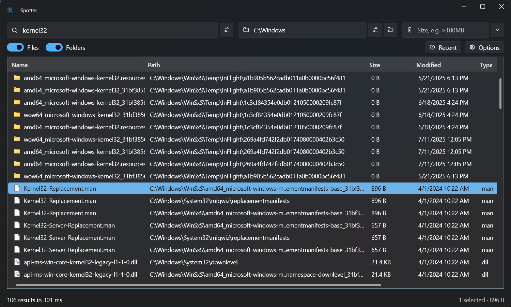

# 🔎 Spotter

Find any file on your PC before you finish typing its name.

Windows Search crawls your disks in the background, misses things, and still makes you wait.
Spotter reads the NTFS master file table directly — the index the filesystem already keeps — so
there is no crawler, no background service, and no waiting for it to "catch up". Every file on
every drive, one keystroke away.

---

## Why Spotter?

- **It is genuinely instant.** 8 drives read in 54 seconds at startup, then 855 results for
  `notepad` in **228 ms**. Not "fast for a search tool" — fast enough that you keep typing and
  the list keeps up.
- **It is one file, and it stays one file.** Drop `Spotter.exe` on your desktop, a USB stick, or
  straight into `C:\` and run it from there for good. It writes nothing beside itself — no logs,
  no config, no folder appearing next to it.
- **It closes when you close it.** No tray icon by default, no process left holding your drives.
  Click X and it is gone, so removing a USB stick still works.
- **It tells you where it keeps things.** Options lists every file and scheduled task it creates
  on your PC, with a button to open each one and to remove them.
- **It speaks your language.** Six of them, including Hebrew and Arabic laid out properly right
  to left — not a mirrored English window.

---

## ✨ Features

🔍 **Search as you type** • 📁 **Filter by name, folder and size** • 🔤 **Per-field case & regex**
• 📏 **Real size grammar** (`> 50 MB`, `~1 GB`, `100 MB To 1 GB`) • 📂 **Folder sizes and contents**
• 🕘 **Recent searches** • ↕️ **Natural sorting** (`file2` before `file10`) • 📤 **CSV & text export**
• 🗑️ **Delete to Recycle Bin** • 🖱️ **Drag results into any app** • ⌨️ **Global hotkey**
• 🌍 **6 languages, 2 right-to-left** • 🌗 **Follows your Windows theme**

### A few worth explaining

**Folder sizes.** Folders show what is actually inside them — total bytes, file count, subfolder
count — because the index adds every file to its parents as it reads. A size filter therefore
matches folders too.

**Per-field options.** Case sensitivity and regular expressions belong to the *field*, not the
search. A case-sensitive filename inside a loosely matched folder is a different question from
the reverse, and both are one click away.

**It tells you when a filter is wrong.** A broken regular expression or an unparseable size turns
that field red and says why, instead of quietly returning zero results that look exactly like
"nothing matched".

---

## 📸 Screenshot



---

## 📋 Requirements

**To run**
- Windows 10 (1809) or 11, 64-bit
- [.NET 8 Desktop Runtime](https://dotnet.microsoft.com/download/dotnet/8.0) — or grab the
  self-contained build, which needs nothing
- Administrator rights: reading the file table needs a raw volume handle. Spotter asks once, then
  registers a scheduled task so later launches from the same folder start without a prompt.

**To build**
- .NET 8 SDK
- A search engine — see below

---

## 🚀 Getting Started

```bash
# Debug build with symbols
build-debug.bat

# Release: one 7 MB exe, needs the .NET 8 Desktop Runtime on the target PC
publish.bat

# Release: one 66 MB exe that runs on any Windows x64 with nothing preinstalled
publish.bat full
```

Both modes publish **a single `Spotter.exe`** and nothing else — the engine, WPF-UI, the runtime
configuration, the debug symbols and WPF's native libraries are all bundled inside it.

Then just start typing. Useful switches while developing:

```bash
Spotter.exe --demo 250000   # fake rows: no admin, no engine, for exercising the UI
Spotter.exe --noelevate     # stay an ordinary process, so it can be focused and killed normally
Spotter.exe --lang he       # force a language for one run without changing the saved setting
Spotter.exe --search TERM   # preload the search box
Spotter.exe --bench 3       # re-run the startup query and log how long each pass took
```

---

## ⚠️ The search engine is not in this repository

`src/Spotter` is the application — the window, the search plumbing, the six languages, the
settings. That is what lives here, and it is what the licence covers.

The component that actually reads the file table sits in `engine/`, which is excluded by
`.gitignore`. **A fresh clone will not build until that project exists**: `Spotter.csproj` has a
`ProjectReference` to `..\..\engine\Core\Spotter.Core.csproj`, so the build stops with a
missing-project error rather than anything mysterious.

To build it yourself, supply an engine behind the same small surface — start indexing, report
progress per volume, run a compiled query, stream results back. [`SearchEngine.cs`](src/Spotter/SearchEngine.cs)
is the entire boundary. It is one file, and it is the only place in the app that knows what the
engine looks like.

---

## 🛠️ Tech Stack

- **WPF** on **.NET 8**, with [WPF-UI](https://github.com/lepoco/wpfui) for Fluent styling and a
  Mica backdrop
- **Virtualized results** — rows are built on demand and capped, so a million-row result set
  costs the same as a hundred
- **Staged updates** — the engine answers on its own threads by the hundred thousand; results are
  queued and drained on a timer instead of being marshalled one at a time
- **Compiled localization** — six plain dictionaries in the executable, no satellite assemblies,
  no folders beside the exe

### Where it puts things

| | |
|---|---|
| Settings | `%APPDATA%\Spotter\settings.xml` |
| Log | `%LOCALAPPDATA%\Spotter\Spotter.log` |
| Engine log (off by default) | `%LOCALAPPDATA%\Spotter\Spotter.Engine.log` |
| Elevation task | Task Scheduler, named after the exe's path — moving Spotter deletes the old one |

**Beside the executable: nothing.** Options lists all of the above with a button to open each one,
and to remove the scheduled task.

Design decisions, the measurements behind them, and the mistakes found along the way are written
up in [src/Spotter/README.md](src/Spotter/README.md).

---

## 🗺️ Ideas for later

- 🔤 Search inside file contents
- 🖼️ Preview pane
- 📌 Saved searches
- 🌐 More languages

---

## 📄 License

Licensed under the [Apache License 2.0](LICENSE) — use it, change it, ship it, including
commercially, as long as you keep the notice and state what you changed.

---

## 👤 Author

Made by **[ori-halevi](https://github.com/ori-halevi)**.

Contributions, ideas, and issues are welcome.
